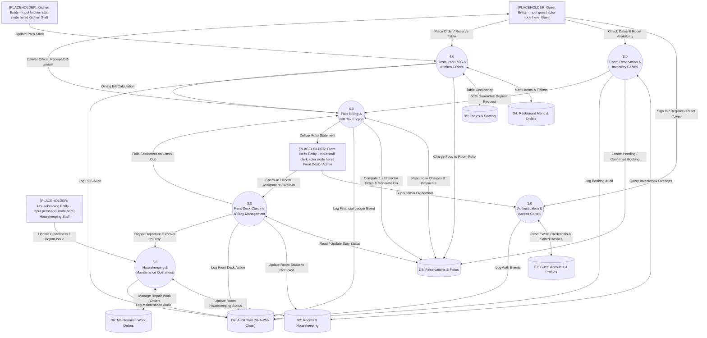
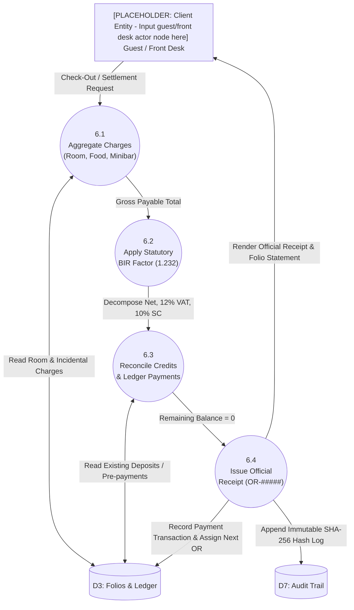

# Data Flow Diagrams (DFD) — PUPSJ Hotel & Restaurant Management System
**Course**: Systems Analysis and Design (SAD)  
**Location Context**: San Juan City, Metro Manila, Philippines  
**System Scope**: Property Management System (PMS), Restaurant Point of Sale (POS), Guest Portal & CRM

---

## 1. Context Diagram (Level 0 DFD)

The Context Diagram defines the system boundary for the PUPSJ Hotel & Restaurant System. It illustrates all external entities interacting with the central system through incoming and outgoing data flows.

```mermaid
graph TD
    %% External Entities
    Guest["[PLACEHOLDER: Guest Entity - Input guest actor node here] Guest / Public Visitor"]
    FrontDesk["[PLACEHOLDER: Front Desk Entity - Input staff clerk actor node here] Front Desk / Superadmin"]
    Kitchen["[PLACEHOLDER: Kitchen Entity - Input kitchen staff node here] Kitchen / Restaurant Staff"]
    Housekeeping["[PLACEHOLDER: Housekeeping Entity - Input personnel node here] Housekeeping & Maintenance Personnel"]
    BIR["[PLACEHOLDER: BIR Entity - Input government tax authority node here] Bureau of Internal Revenue (BIR)"]

    %% Central Process
    System(("&nbsp;&nbsp;0.0&nbsp;&nbsp;<br/>PUPSJ Hotel & Restaurant<br/>Management System"))

    %% Data Flows: Guest
    Guest -- "Booking Request / Stay Dates / Guest Info" --> System
    Guest -- "Payment Details (Deposit / Card / GCash / Maya)" --> System
    Guest -- "Table Reservation / Dining Order Request" --> System
    Guest -- "Service Request (Housekeeping / Late Check-Out)" --> System
    System -- "Booking Confirmation (HTL-#####)" --> Guest
    System -- "BIR-Compliant Invoice / Official Receipt (OR-#####)" --> Guest
    System -- "Dining Order Confirmation / Ticket" --> Guest
    System -- "Wi-Fi Passcode (Active Stay Only)" --> Guest

    %% Data Flows: Front Desk
    FrontDesk -- "Walk-In Reservation / Room Assignment" --> System
    FrontDesk -- "Check-In / Check-Out Processing" --> System
    FrontDesk -- "Manual Room Folio Adjustments / Charges" --> System
    FrontDesk -- "Property Configuration / Rates / Promos" --> System
    System -- "Real-Time Occupancy & Room Status Board" --> FrontDesk
    System -- "Guest Folio Ledger & Balance Alerts" --> FrontDesk
    System -- "Tamper-Evident Audit Trail" --> FrontDesk

    %% Data Flows: Restaurant
    Kitchen -- "Kitchen Ticket Status Updates (Preparing / Ready / Served)" --> System
    Kitchen -- "Menu Stock / 86 Toggles" --> System
    System -- "Live Kitchen Display Orders (KDS)" --> Kitchen
    System -- "Table Reservation Timeline / Seating Schedule" --> Kitchen

    %% Data Flows: Housekeeping
    Housekeeping -- "Cleaning Status (Clean / Dirty / Inspecting)" --> System
    Housekeeping -- "Maintenance Work Orders (Out-of-Service / Resolved)" --> System
    System -- "Housekeeping Task Queue & Room Priorities" --> Housekeeping
    System -- "Work Order Assignments" --> Housekeeping

    %% Data Flows: BIR / Compliance
    System -- "Official BIR Tax Reports (Net, 12% VAT, 10% SC, OR Register)" --> BIR
```



---

## 2. DFD Level 0 (System Decomposition)

The Level 0 Diagram decomposes the system into six primary operational subsystems and seven central data stores.



---

## 3. DFD Level 1 Subsystem Decompositions

### 3.1 Subsystem 2.0: Room Reservation & Inventory Control

```mermaid
graph TD
    Guest["[PLACEHOLDER: Guest Entity - Input guest actor node here] Guest"]
    D2[("D2: Rooms Inventory")]
    D3[("D3: Reservations")]
    D7[("D7: Audit Trail")]

    P2_1(("2.1<br/>Validate Stay Dates<br/>& Guest Capacity"))
    P2_2(("2.2<br/>Interval Collision<br/>Algorithm"))
    P2_3(("2.3<br/>Apply Promotions<br/>& Calculate Pricing"))
    P2_4(("2.4<br/>Generate Booking<br/>& Assign Expiry Hold"))

    Guest -->|Stay Dates (ci, co, guests)| P2_1
    P2_1 -->|Valid Dates & Guest Count| P2_2
    P2_2 <-->|Query Overlapping Non-Cancelled Stays| D3
    P2_2 <-->|Exclude Out-of-Service Rooms| D2
    P2_2 -->|Available Room List| P2_3
    P2_3 -->|Base Rate, Nights, Discounts| P2_4
    P2_4 -->|Create HTL-##### (Pending 24h Hold or Confirmed)| D3
    P2_4 -->|Log New Booking| D7
    P2_4 -->|Return Booking Confirmation| Guest
```

### 3.2 Subsystem 6.0: Folio Billing & BIR Tax Engine

In compliance with Philippine Tax Regulations (National Internal Revenue Code / BIR Revenue Regulations):
- Gross sales are subject to $12\%$ Value-Added Tax (VAT) and $10\%$ Service Charge (SC).
- Total billing factor: $1 + 0.12 + 0.10 = 1.22$ (or compounding/combined factor $1.232$ where $10\%$ SC is applied on pre-VAT or inclusive total).
- Formula implemented across the system:
  $$\text{Net Sales (Vatable Base)} = \frac{\text{Gross Total}}{1.232}$$
  $$\text{Service Charge (10\%)} = \text{Net Sales} \times 0.10$$
  $$\text{Vatable Sales (Base + SC)} = \text{Net Sales} \times 1.10$$
  $$\text{Output VAT (12\%)} = \text{Vatable Sales} \times 0.12$$
  $$\text{Check}: \text{Net} + \text{SC} + \text{VAT} = \text{Gross Total}$$


