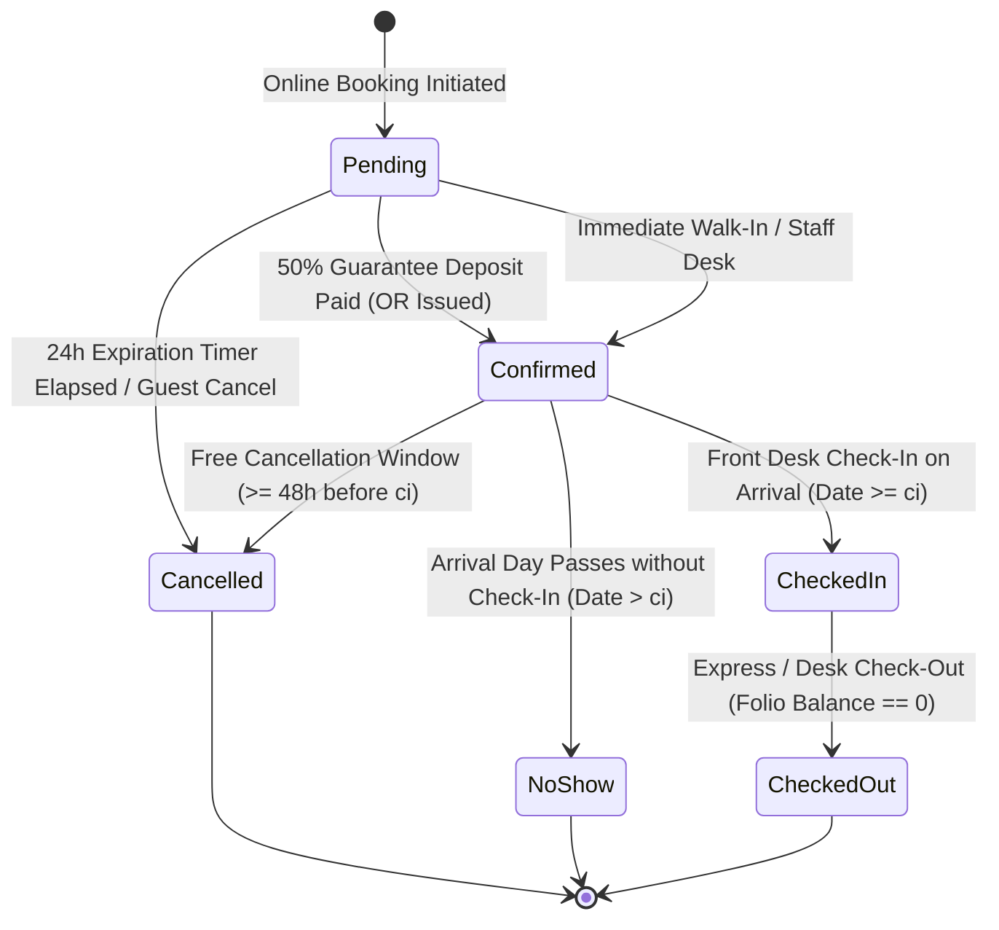
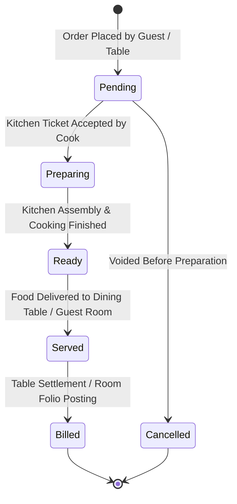
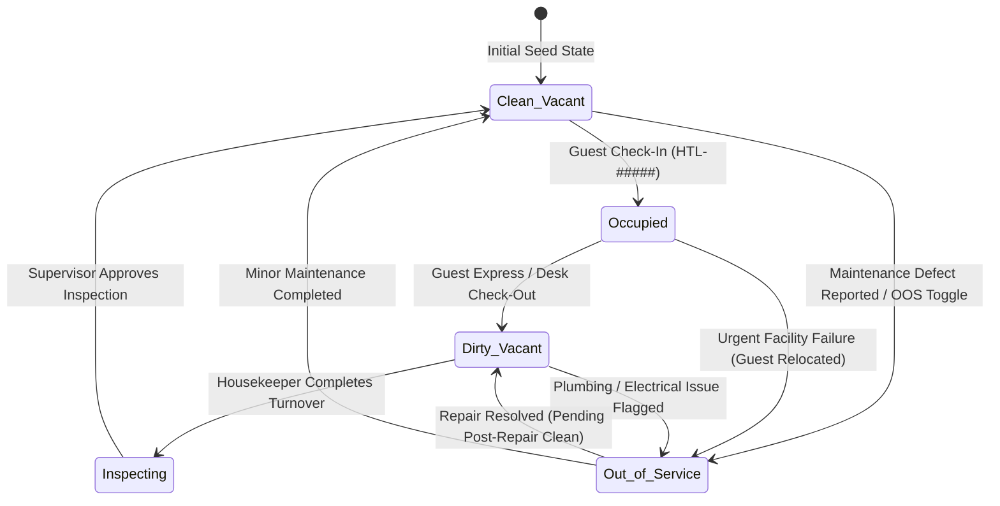

# State Machine Diagrams & Transition Matrices
**Course**: Systems Analysis and Design (SAD)  
**Location Context**: San Juan City, Metro Manila, Philippines  
**System Scope**: PUPSJ Hotel & Restaurant Management System

---

## 1. Reservation State Machine

### 1.1 State Diagram

### 1.2 Transition Matrix

| Initial State | Event / Trigger | Guard Condition | Target State | Side Effects & Actions |
| :--- | :--- | :--- | :--- | :--- |
| `[None]` | Web booking initiated | Valid dates, capacity OK | `Pending` | Set 24h `holdExpiresAt`, calculate 50% deposit due. |
| `Pending` | Payment received | Amount $\ge$ 50% deposit | `Confirmed` | Issue BIR `OR-#####`, clear `holdExpiresAt`, lock room allocation. |
| `Pending` | Hold expires | `now() > holdExpiresAt` | `Cancelled` | Release room allocation back to free inventory pool. |
| `Confirmed` | Guest arrives | Date $\ge$ Check-in date | `Checked-in` | Record check-in time, set physical room HK status to `Occupied`. |
| `Confirmed` | Cancellation requested | Lead time $\ge$ 48 hours | `Cancelled` | Full refund policy notice, release room inventory. |
| `Confirmed` | Cancellation requested | Lead time $<$ 48 hours | `Cancelled` | Forfeit 50% guarantee deposit per hotel terms, release room. |
| `Confirmed` | Day passes | Date $>$ Check-in date | `No-show` | Mark No-show, retain deposit, release room for walk-ins. |
| `Checked-in` | Departure | Folio Balance $== 0$ | `Checked-out` | Mark room `Dirty` (Urgent if arrival today), award loyalty points. |

---

## 2. Restaurant Order State Machine

### 2.1 State Diagram

### 2.2 Transition Matrix

| Initial State | Event / Trigger | Guard Condition | Target State | Side Effects & Actions |
| :--- | :--- | :--- | :--- | :--- |
| `[None]` | Order created | Valid items in stock | `Pending` | Generate `ORD-#####`, transmit to Kitchen Display (KDS). |
| `Pending` | Kitchen accepts | Cook clicks "Start Cooking"| `Preparing` | Start amber SLA timer (30 min standard prep). |
| `Pending` | Order voided | Waiter cancellation | `Cancelled` | Log void in audit trail, restock ingredients. |
| `Preparing` | Cooking complete | Cook clicks "Mark Ready" | `Ready` | Flash notification to expeditor/servers for pickup. |
| `Ready` | Delivered | Server marks "Served" | `Served` | Update service delivery timestamp. |
| `Served` | Settlement | Paid Cash/Card OR Room Charge| `Billed` | Generate dining OR or post to `FOLIO_CHARGE` in hotel PMS. |

---

## 3. Physical Room Operational State Machine

The operational status of each room is a compound matrix of **Occupancy** (`Vacant` vs `Occupied`) and **Cleanliness** (`Clean`, `Inspecting`, `Dirty`, `Out-of-Service`).

### 3.1 State Diagram

### 3.2 Transition Matrix

| Initial State | Event / Action | Guard Condition | Target State | System Actions |
| :--- | :--- | :--- | :--- | :--- |
| `Clean / Vacant` | Check-in processed | Reservation status `Confirmed` | `Occupied` | Lock room from booking, update room badge to Blue `Occupied`. |
| `Occupied` | Check-out processed | Folio balance settled | `Dirty / Vacant` | Auto-assign priority: `Urgent` if next arrival is today, else `High`. |
| `Dirty / Vacant` | Housekeeper completes | Bedding & amenities restocked | `Inspecting` | Move to supervisor inspection queue. |
| `Inspecting` | Supervisor sign-off | Quality checklist passed | `Clean / Vacant` | Return to available booking pool, update badge to Green `Clean`. |
| Any State | OOS Toggle / Work Order | Mechanical defect reported | `Out-of-Service` | Exclude room from all inventory collision algorithms; alert desk. |
| `Out-of-Service` | Work order resolved | Technician marks resolved | `Dirty / Vacant` | Place in cleaning queue prior to re-leasing to guests. |
