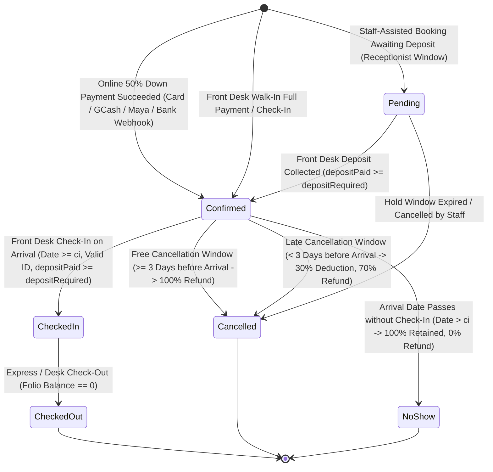
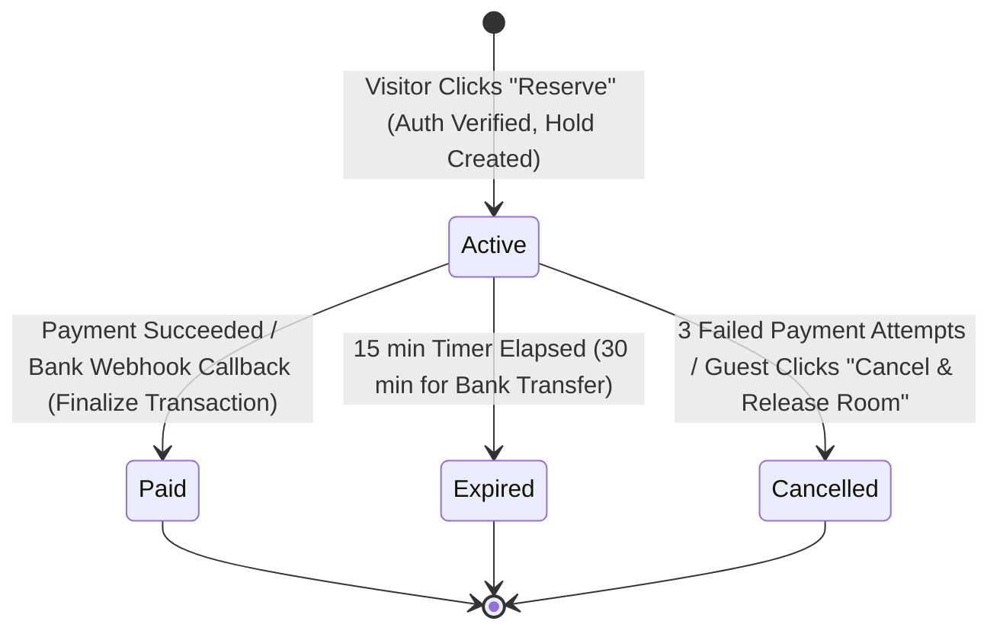
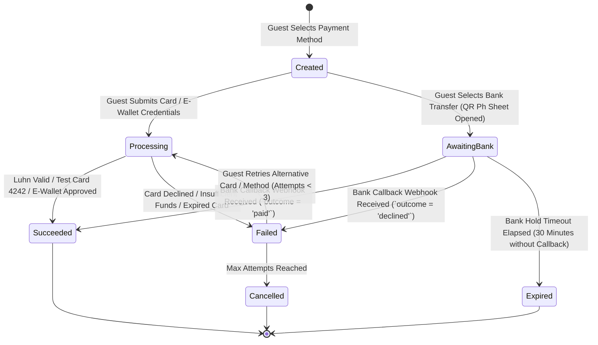
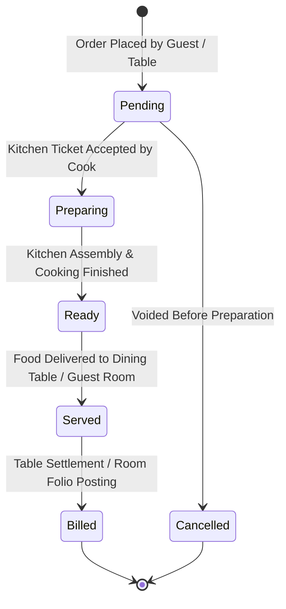
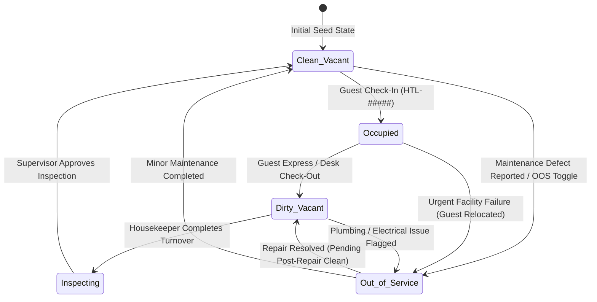

# State Machine Diagrams & Transition Matrices
**Course**: Systems Analysis and Design (SAD)  
**Location Context**: San Juan City, Metro Manila, Philippines  
**System Scope**: PUPSJ Hotel & Restaurant Management System

---

## 1. Reservation & Inventory Hold State Machines

### 1.1 Reservation State Diagram

Online reservations are created directly in the `Confirmed` state upon verified payment settlement. The `Pending` state is never used for online bookings and exists solely for staff-assisted front-desk bookings awaiting an in-person deposit window.

### 1.2 Reservation Transition Matrix

| Initial State | Event / Trigger | Guard Condition | Target State | Side Effects & Actions |
| :--- | :--- | :--- | :--- | :--- |
| `[None]` | Online Down Payment | `PaymentIntent.status == Succeeded`, room unit available | `Confirmed` | Issue BIR `OR-#####`, record unified payment, open folio with deposit credit, consume hold, assign room, send guest confirmation voucher & hotel notification. `confirmedBy: 'System (payment)'`. |
| `[None]` | Staff-Assisted Booking | Staff session, temporary hold window specified | `Pending` | Holds room unit temporarily until receptionist-chosen deadline. |
| `Pending` | Deposit Settled | Amount $\ge$ 50% required deposit | `Confirmed` | Issue BIR `OR-#####`, lock allocation, notify guest. |
| `Pending` | Staff Hold Expires | Current time $>$ hold deadline | `Cancelled` | Release inventory back to free pool. |
| `Confirmed` | Guest Arrives | Date $\ge$ Check-in date, valid Govt ID recorded, `depositPaid >= depositRequired` | `Checked-in` | Record check-in timestamp, update physical room HK status to `Occupied`. |
| `Confirmed` | Cancellation ($\ge 3$ days) | `daysUntilArrival >= CONFIG.freeCancelDays` (3 days) | `Cancelled` | Issue 100% full refund (`Refund` payment with unique OR), release room inventory, release promo if redeemed. |
| `Confirmed` | Cancellation ($< 3$ days) | `daysUntilArrival < CONFIG.freeCancelDays` (3 days) | `Cancelled` | Deduct 30% fee (`CONFIG.lateCancelFeePct`), refund remaining 70% (`Refund` payment with unique OR), release room inventory. |
| `Confirmed` | No-Show | Current date $>$ Check-in date | `No-show` | Forfeit 100% of payments received (0% refund), record audit trail, release room inventory for walk-ins. |
| `Checked-in` | Departure Checkout | Folio Balance $== 0$ (or Admin approval override) | `Checked-out` | Mark room `Dirty` (Urgent if next arrival today), award loyalty points. |

---

### 1.3 BookingHold State Machine

Protects room inventory while the guest enters credentials and executes payment.

#### BookingHold Transition Matrix

| Initial State | Event / Trigger | Guard Condition | Target State | Side Effects & Actions |
| :--- | :--- | :--- | :--- | :--- |
| `[None]` | `BookingService.startHold` | Guest session active, dates valid, `unitsFree >= 1` | `Active` | Generates `HLD-#####`, sets `expiresAt = now + 15m` (extended to 30m for bank), locks 1 room inventory unit. |
| `Active` | Payment Succeeded | `PaymentIntent.status == Succeeded` | `Paid` | Consumes hold, finalizes `Reservation` as `Confirmed`. |
| `Active` | Expiration Timer | `Date.now() >= expiresAt` | `Expired` | Releases locked room inventory unit back to free pool, releases promo code. |
| `Active` | Max Attempts Reached | `attempts >= CONFIG.maxPayAttempts` (3) | `Cancelled` | Releases inventory hold, informs guest to re-select dates. |
| `Active` | Guest Releases Room | Guest clicks "Cancel and release room" | `Cancelled` | Immediately unlocks room unit, cancels active payment intents. |

---

### 1.4 PaymentIntent State Machine

Tracks payment lifecycle across simulated gateways and webhook callbacks.

---

## 2. Restaurant Order State Machine

### 2.1 State Diagram

### 2.2 Transition Matrix

| Initial State | Event / Trigger | Guard Condition | Target State | Side Effects & Actions |
| :--- | :--- | :--- | :--- | :--- |
| `[None]` | Order created | Valid items in stock | `Pending` | Generate `ORD-#####`, transmit to Kitchen Display (KDS). |
| `Pending` | Kitchen accepts | Cook clicks "Start Cooking"| `Preparing` | Start amber SLA timer (30 min standard prep). |
| `Pending` | Order voided | Waiter cancellation | `Cancelled` | Log void in audit trail, restock ingredients. |
| `Preparing` | Cooking complete | Cook clicks "Mark Ready" | `Ready` | Flash notification to expeditor/servers for pickup. |
| `Ready` | Delivered | Server marks "Served" | `Served` | Update service delivery timestamp. |
| `Served` | Settlement | Paid Cash/Card OR Room Charge| `Billed` | Generate dining OR or post to `FOLIO_CHARGE` in hotel PMS. |

---

## 3. Physical Room Operational State Machine

The operational status of each room is a compound matrix of **Occupancy** (`Vacant` vs `Occupied`) and **Cleanliness** (`Clean`, `Inspecting`, `Dirty`, `Out-of-Service`).

### 3.1 State Diagram

### 3.2 Transition Matrix

| Initial State | Event / Action | Guard Condition | Target State | System Actions |
| :--- | :--- | :--- | :--- | :--- |
| `Clean / Vacant` | Check-in processed | Reservation status `Confirmed` | `Occupied` | Lock room from booking, update room badge to Blue `Occupied`. |
| `Occupied` | Check-out processed | Folio balance settled | `Dirty / Vacant` | Auto-assign priority: `Urgent` if next arrival is today, else `High`. |
| `Dirty / Vacant` | Housekeeper completes | Bedding & amenities restocked | `Inspecting` | Move to supervisor inspection queue. |
| `Inspecting` | Supervisor sign-off | Quality checklist passed | `Clean / Vacant` | Return to available booking pool, update badge to Green `Clean`. |
| Any State | OOS Toggle / Work Order | Mechanical defect reported | `Out-of-Service` | Exclude room from all inventory collision algorithms; alert desk. |
| `Out-of-Service` | Work order resolved | Technician marks resolved | `Dirty / Vacant` | Place in cleaning queue prior to re-leasing to guests. |
