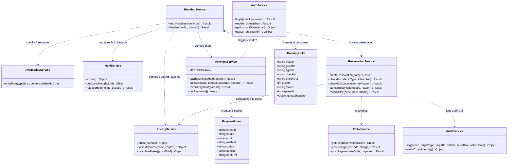
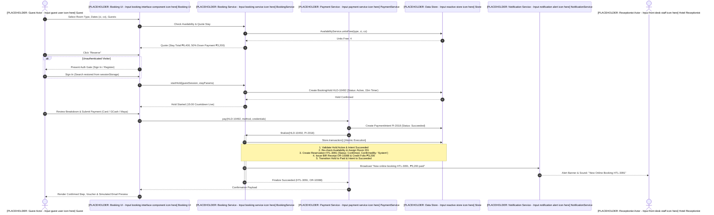
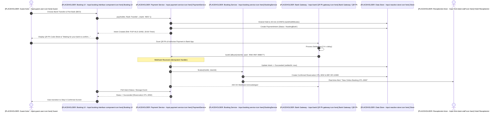
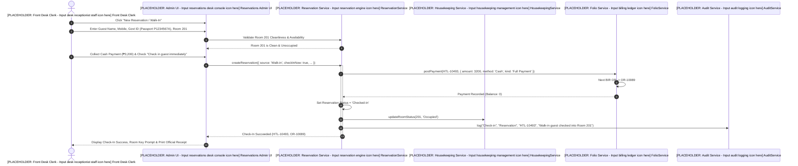
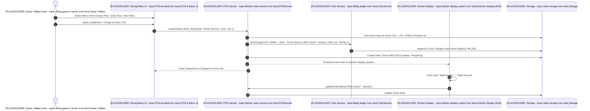
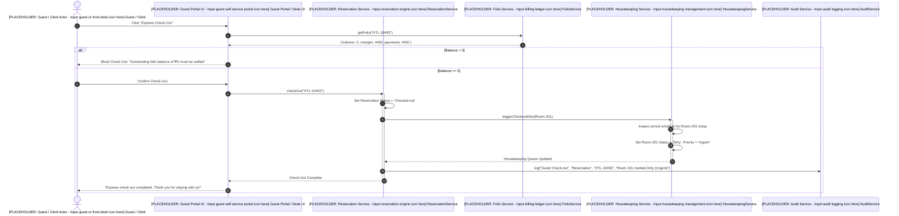

## 0. Use Case Specifications (Online Reservation Engine)

### UC-RES-01: Create Online Room Reservation
- **Primary Actor**: [PLACEHOLDER: Guest Actor - Input online guest user persona here] Online Guest / Visitor
- **Preconditions**:
  1. Room type has at least 1 free unit for requested stay interval $[ci, co)$ (`AvailabilityService.unitsFree >= 1`).
  2. Visitor is authenticated as `guest` (if unauthenticated, the Auth Gate intercepts at the "Reserve" step, preserves search parameters in `sessionStorage`, and resumes immediately post-authentication).
- **Postconditions**:
  1. 15-minute `BookingHold` consumed and marked `Paid`.
  2. 50% down payment recorded in unified payments ledger with sequential BIR `OR-#####`.
  3. Folio initialized with 50% deposit credit and room charges.
  4. Reservation created with status `Confirmed` (`confirmedBy: 'System (payment)'`, source `'Online'`).
  5. Room unit assigned from free pool.
  6. Hotel front desk notified in real-time (`"New online booking HTL-####, ₱__ paid"`).
  7. Instant confirmation voucher rendered with `[PLACEHOLDER: Watermark SIMULATED]`.
- **Main Flow**:
  1. Visitor browses public availability and selects dates, guests, and room type.
  2. System quotes pricing using BIR 1.232 factor and computes 50% deposit due.
  3. Visitor clicks "Reserve". System verifies guest authentication (triggers Auth Gate if needed).
  4. System acquires 15-minute inventory hold (`BookingService.startHold`).
  5. Guest reviews price breakdown and agrees to cancellation policy checkbox.
  6. Guest submits payment via Card, GCash, Maya, or Bank Transfer QR Ph.
  7. System executes `BookingService.finalize()` atomically in `Store.transaction()`.
  8. System renders instant confirmation screen and issues printable voucher.
- **Alternative / Exceptional Flows**:
  - *Late Payment / Expired Hold*: If room is still free, system re-locks unit and confirms. If room is taken, system auto-refunds payment in full, sets intent `Refunded`, and alerts guest.
  - *Payment Declined*: System increments hold attempts, displays inline error, and retains hold if attempts $< 3$.

---

### UC-RES-02: Modify Stay Dates or Room Type
- **Primary Actor**: [PLACEHOLDER: Guest Actor - Input registered guest user persona here] Registered Guest
- **Preconditions**:
  1. Guest has an active `Confirmed` stay in Guest Portal.
  2. Check-in date has not passed (`checkInDate > today()`).
- **Postconditions**:
  1. Reservation record updated with new dates, room type, and nightly rate snapshot.
  2. Any increase in the 50% deposit requirement is collected via instant top-up payment before changes commit.
  3. Room re-allocated; hotel notified.
- **Main Flow**:
  1. Guest opens Guest Portal > My Reservations and clicks "Modify".
  2. Guest selects new dates or room type. System checks availability excluding existing stay.
  3. System recalculates quote. If new 50% deposit exceeds current `depositPaid`, guest pays difference.
  4. System commits modification and updates ledger.

---

### UC-RES-03: Cancel Reservation
- **Primary Actor**: [PLACEHOLDER: Guest Actor - Input registered guest user persona here] Registered Guest
- **Preconditions**:
  1. Guest has an active `Confirmed` stay.
  2. Stay status is not `Checked-in` (checked-in stays require early checkout).
- **Postconditions**:
  1. Reservation status transitioned to `Cancelled`.
  2. Room unit released back to sellable inventory pool.
  3. If $\ge 3$ days prior to arrival (`daysToArrival >= CONFIG.freeCancelDays`), 100% of all payments refunded.
  4. If $< 3$ days prior to arrival, 30% penalty deducted (`CONFIG.lateCancelFeePct = 30`), remaining 70% refunded.
  5. Refund recorded as negative payment with unique BIR `OR-#####`.
  6. Audit trail logged and hotel notified.
- **Main Flow**:
  1. Guest clicks "Cancel" in Guest Portal.
  2. Modal displays refund computation: `"Paid ₱__, deduction (30%) ₱__, you will be refunded ₱__"`.
  3. Guest confirms cancellation. System executes `ReservationService.cancelReservation()`.

---

## 1. Class Diagram (Architecture & Domain Services)

The system follows a clean modular service-oriented architecture implemented in vanilla JavaScript. Services encapsulate domain rules, state mutations, and persistence transactions.

---

## 2. Sequence Diagrams (Core Business Workflows)

### 2.1 Workflow 1: Guest Online Reservation with 50% Guarantee Down Payment & Instant Confirmation

Demonstrates public browsing, auth gate, 15-minute inventory hold, payment intent settlement, atomic finalize transaction, and real-time hotel receptionist notification.

---

### 2.1b Workflow 1b: Bank Transfer QR Ph Gateway Webhook Callback

Demonstrates the 30-minute extended hold, QR Ph simulation sheet, and automated gateway webhook callback confirming the booking without manual staff intervention.

---

### 2.2 Workflow 2: Front Desk Walk-In Check-In with BIR Official Receipt Generation

Demonstrates immediate walk-in registration, mandatory government photo ID recording, room assignment, front desk cash settlement, and room occupancy status toggle.

---

### 2.3 Workflow 3: In-Room Dining Order Charged to Hotel Room Folio

Demonstrates order placement from the restaurant/room-service module, kitchen ticket management, folio ledger posting, and balance recalculation.

---

### 2.4 Workflow 4: Housekeeping Turnover on Express Check-Out

Demonstrates guest-initiated or front-desk check-out, automated balance verification, cascading room status to `Dirty` with turnaround priority assignment, and cleaning completion.

