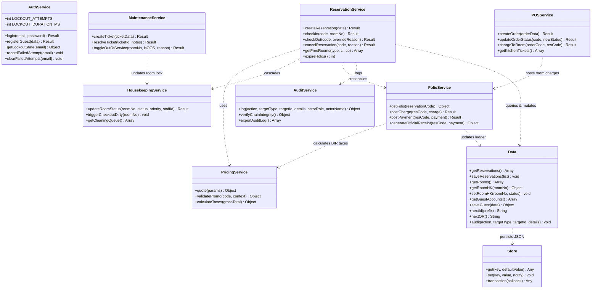
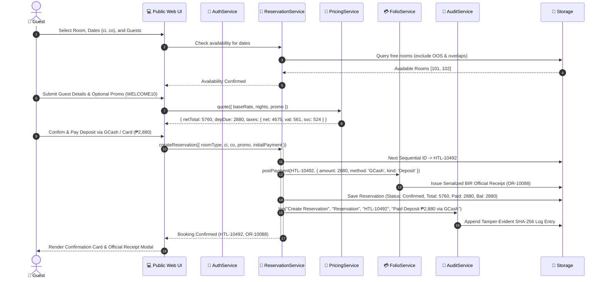
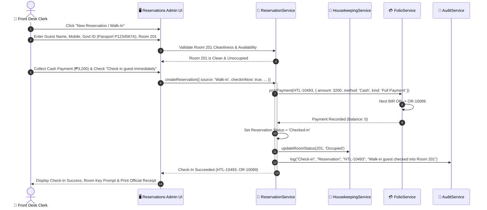
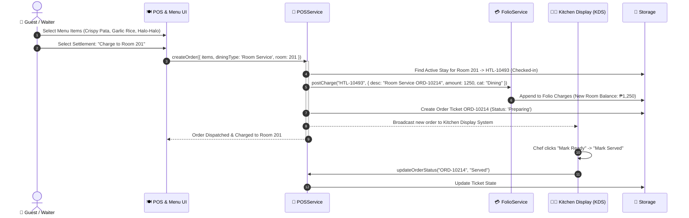
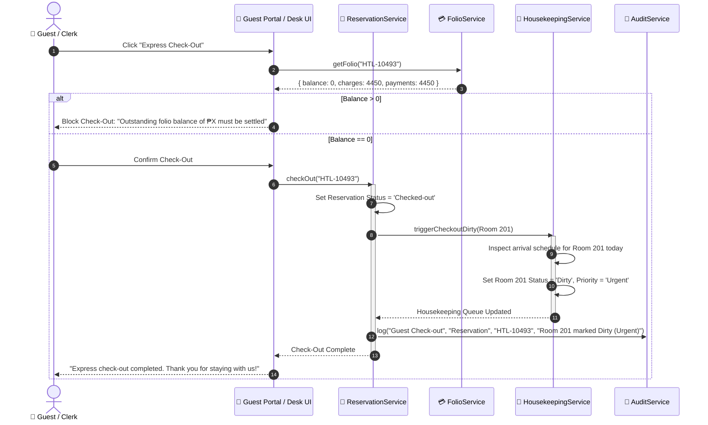

# UML Class & Sequence Diagrams
**Course**: Systems Analysis and Design (SAD)  
**Location Context**: San Juan City, Metro Manila, Philippines  
**System Scope**: PUPSJ Hotel & Restaurant Management System

---

## 1. Class Diagram (Architecture & Domain Services)

The system follows a clean modular service-oriented architecture implemented in vanilla JavaScript. Services encapsulate domain rules, state mutations, and persistence transactions.

---

## 2. Sequence Diagrams (Core Business Workflows)

### 2.1 Workflow 1: Guest Online Reservation with 50% Guarantee Deposit & Hold Expiration

Demonstrates customer booking, pricing quote with 1.232 factor tax decomposition, 50% deposit settlement, and immediate confirmation.

---

### 2.2 Workflow 2: Front Desk Walk-In Check-In with BIR Official Receipt Generation

Demonstrates immediate walk-in registration, mandatory government photo ID recording, room assignment, front desk cash settlement, and room occupancy status toggle.

---

### 2.3 Workflow 3: In-Room Dining Order Charged to Hotel Room Folio

Demonstrates order placement from the restaurant/room-service module, kitchen ticket management, folio ledger posting, and balance recalculation.

---

### 2.4 Workflow 4: Housekeeping Turnover on Express Check-Out

Demonstrates guest-initiated or front-desk check-out, automated balance verification, cascading room status to `Dirty` with turnaround priority assignment, and cleaning completion.

